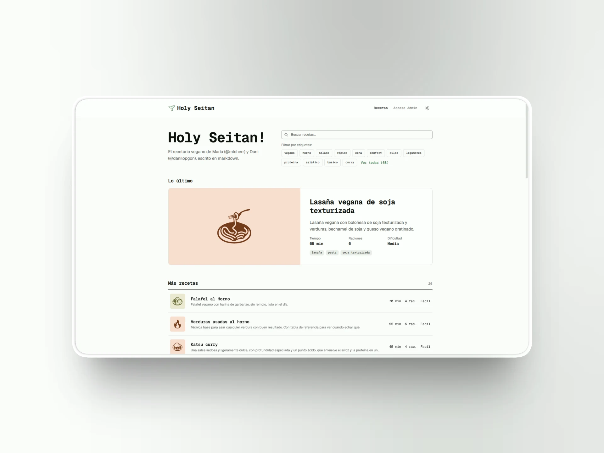

# 🥦 Holy Seitan

**Holy Seitan** es el recetario vegano de [María López Herráiz](https://github.com/mloherr) y [Dani López González](https://github.com/danilopgon), pensado para leerlo desde la encimera mientras cocinamos.
Cada receta tiene su preparación en Markdown y sus ingredientes como datos aparte, se guarda en Supabase y se ve directamente en la web. Hay un panel de administración y, además, se pueden editar recetas desde una conversación con Claude o ChatGPT.

> A María el Notion free le dijo “hasta aquí”... y en lugar de pagar el plan, hicimos esta movida 🤷‍♂️



---

## 🍳 Funcionalidades

- **Portada tipo índice**: buscador, las etiquetas más usadas y la última receta en grande.
- **Ficha en dos columnas**: emoji, tiempos, raciones e ingredientes fijos a un lado; la preparación al otro.
- **Multiplicador de ingredientes** ×0,5 / ×1 / ×2 / ×3, con fracciones de cocina y raciones adaptadas. Nunca cambia lo guardado.
- **Pantalla encendida** mientras sigues la receta (Screen Wake Lock).
- **Modo claro y oscuro**: sigue al sistema y recuerda tu elección.
- **Panel `/admin`** para crear, editar y borrar recetas, con editor de ingredientes (grupos, orden y "pegar lista").
- **Historial de versiones**: cada cambio guarda la versión anterior y dos ediciones a la vez nunca se pisan.
- **Edición por agentes (MCP)**: le pides a Claude o ChatGPT que cree una receta o cambie una existente; te enseña la propuesta y solo se guarda si la apruebas.

---

## 🤖 Recetas desde una conversación (MCP)

Holy Seitan tiene su propio servidor [MCP](https://modelcontextprotocol.io) en una Edge Function de Supabase. El agente puede buscar y leer recetas, proponer un cambio acotado o una receta nueva con su vista previa, aplicarla cuando la apruebas y deshacerla desde el historial.

Entra con vuestra propia cuenta (OAuth 2.1 con pantalla de consentimiento) y actúa con vuestros permisos, así que nadie más puede escribir. Las conexiones se revocan desde `/admin`.

Cómo conectarlo y qué hace cada herramienta: [`docs/mcp.md`](docs/mcp.md).

---

## 🔐 Autenticación

Solo María y Dani tienen cuenta, y las altas están cerradas. Las recetas publicadas se ven libremente desde la home; crear, editar y borrar es solo para admins, y lo garantizan las políticas RLS de Supabase, no la interfaz.

---

## 🌱 Stack

- **Next.js 16 (App Router)** con React 19 y TypeScript
- **Supabase**: Postgres con RLS, Auth (y servidor OAuth 2.1) y Edge Functions
- **MCP**: bloque oficial de Supabase (`@supabase/server`) en Deno
- **Drizzle ORM**: esquema tipado
- **Zustand**: estado global
- **Shadcn/UI + TailwindCSS v4**, con Geist Mono y emojis en Noto Emoji

---

## 🛠️ Desarrollo

```sh
cp env.example .env.local   # NEXT_PUBLIC_SUPABASE_URL y NEXT_PUBLIC_SUPABASE_PUBLISHABLE_KEY
pnpm install
pnpm dev
```

| Comando | Qué comprueba |
|---|---|
| `pnpm test` | Ingredientes: parseo, escala, formato y adaptador |
| `pnpm test:functions` | Servidor MCP: contrato de ediciones, diff y recetas nuevas (Deno) |
| `pnpm test:db` | Base de datos: RLS, versiones, historial y restauración (pgTAP, Supabase local) |
| `pnpm mcp:smoke` | De principio a fin: OAuth y todas las herramientas MCP contra Supabase local |
| `pnpm lint` / `pnpm build` | Lint y build de producción |

Cómo levantar Supabase en local: [`docs/mcp.md`](docs/mcp.md#desarrollo-local).
